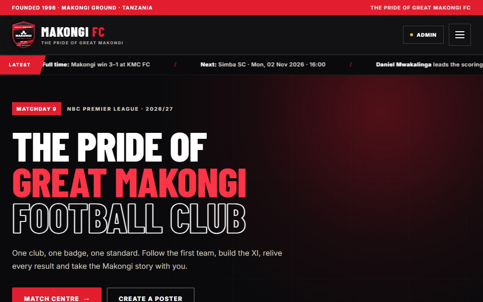

# Makongi FC

**A football club site with a real team sheet: squad, formation, fixtures, standings and matchday posters.**

[Live demo](https://football-club-022114646468401970169.vercel.app) | HTML, CSS and JavaScript, no build step



A public club site and a private admin dashboard for a local football club. Supporters get the squad,
the starting XI in a chosen formation, fixtures and results, player statistics and the league table.
The club gets a place to publish all of it without touching code.

## What it does

- **Squad and starting XI.** Pick a formation and the pitch redraws; player cards carry position,
  number and season stats.
- **Fixtures and results**, with past and upcoming matches in one list.
- **Player statistics** and a computed league table.
- **Matchday and birthday posters**, generated from the squad data rather than designed by hand each
  week.
- **Club news** for announcements.
- **An admin dashboard** where the club manages players, fixtures, results and news behind a gate.

## Run it locally

```bash
node dev-server.mjs
```

Open <http://127.0.0.1:4173>. Nothing to install.

## Verify

```bash
node scripts/verify.mjs
node scripts/render-smoke.mjs
```

`scripts/verify.mjs` checks the data model, standings math, formation shapes and required assets.
`scripts/render-smoke.mjs` renders every view against a DOM stub so template errors surface without a
browser.

## How it is built

| Path | Purpose |
|---|---|
| `index.html` | The club site and admin shell |
| `assets/` | App modules, styles and local imagery |
| `scripts/verify.mjs` | Data, standings and formation verification |
| `scripts/render-smoke.mjs` | View rendering smoke test |
| `dev-server.mjs` | Zero-dependency local preview server |

## What is simulated

The squad, fixtures, results and news are seeded sample data. The admin session, image uploads and
persistence are simulated; there is no database or authentication server.

## About this prototype

Built as a working prototype for a real brief, then published as part of a portfolio. The part worth
looking at is the club as data: the XI, the table, the posters and the stats all read the same squad
record, so a result entered once updates everything.
